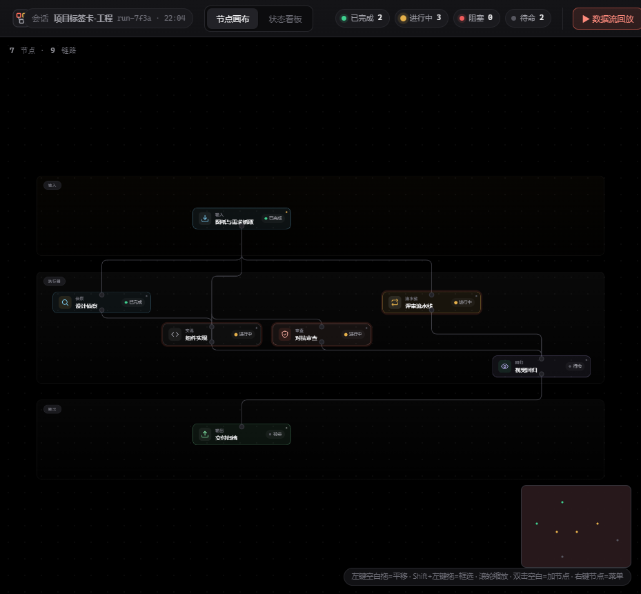
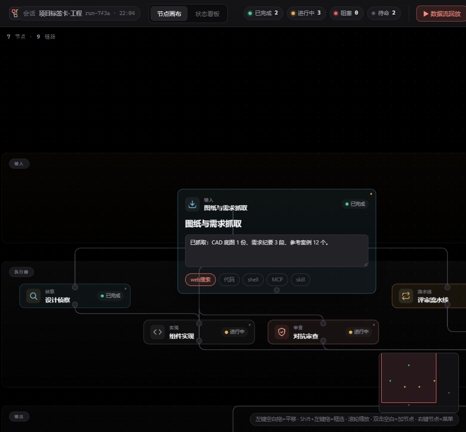
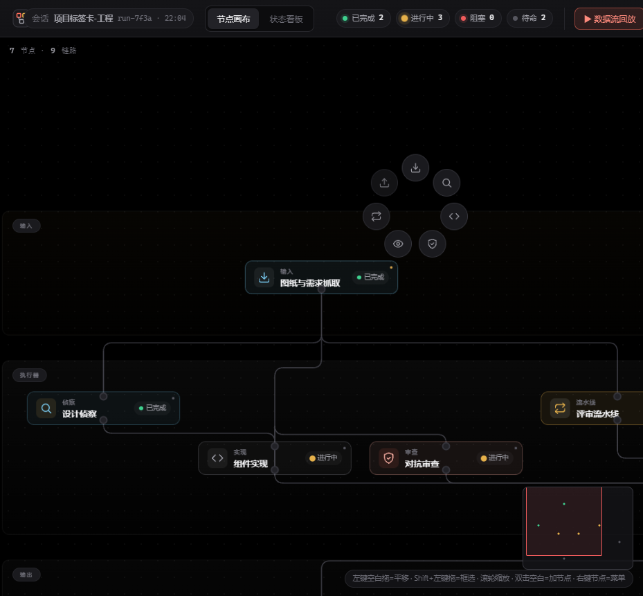

# DSH Workflow Canvas

> 拖节点、连线、配 prompt，一条 Agent 流水线就搭好了。

---

## 全景

纯黑背景，垂直三带流水线：输入在顶、执行器在中、输出在底。节点带类型着色，连线是数据流。

---

## 交互

<table>
<tr>
<td width="50%">
<b>点节点 → 原地展开编辑</b>
 

</td>
<td width="50%">
<b>双击空白 → radial 加节点</b>
 

</td>
</tr>
</table>

---

## 功能

|  |  |
|---|---|
| **垂直流水线** | 输入 → 执行器 → 输出，数据从上往下流 |
| **原地展开编辑** | 点节点变大成表单，改名字/prompt/工具 |
| **7 种节点类型** | 输入/侦察/实现/审查/回归/流水线/输出 |
| **拖线连线** | out port → in port 创建连接 |
| **双击加节点** | radial 菜单选类型 |
| **框选多选** | Shift+左键拖 |
| **自动布局** | Sugiyama 一键整理 |
| **小地图** | 右下角导航 |
| **对齐吸附** | 拖节点自动对齐 |
| **错误状态** | 跑炸变红脉冲 |
| **数据流回放** | 动画跑一遍 |
| **持久化** | localStorage 自动存 |
| **撤销** | Ctrl+Z |
| **折叠组** | 框选 → 右键折叠 |

## 快捷键

| 键 | 动作 |
|---|---|
| 左键空白拖 | 平移 |
| Shift+左键拖 | 框选 |
| 滚轮 | 缩放 |
| 双击空白 | 加节点 |
| Delete | 删除 |
| Ctrl+Z | 撤销 |

## 技术栈

- 纯原生 HTML/CSS/JS，零构建
- SVG 正交连线
- localStorage 持久化
- 纯黑背景深色设计

## License

MIT
