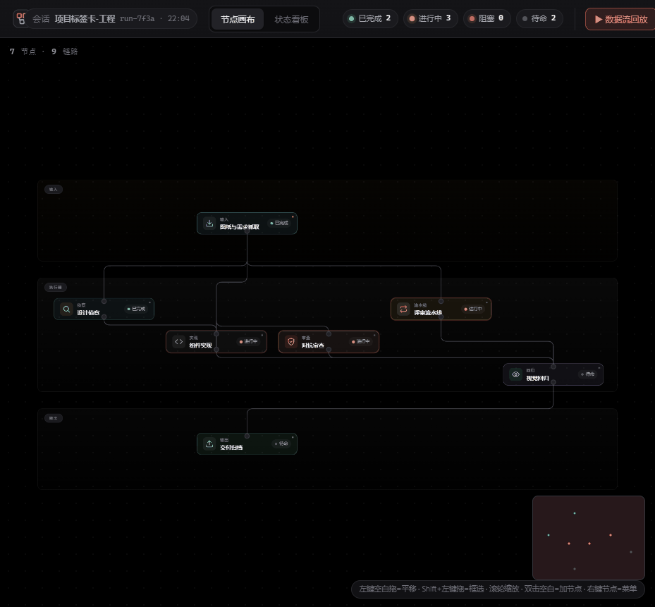

<div align="center">

# DSH Workflow Canvas

<br/>

**编排多 Agent，像画流程图一样简单。**

<br/>


&nbsp;

&nbsp;


<br/><br/>



</div>

---

<div align="center">

## 为什么做

DSH 里多 Agent 跑起来是黑盒。<br/>
谁调了谁、数据怎么流、哪一步炸了，全靠翻日志。

Workflow Canvas 把它变成一张图。<br/>
拖节点、连线、配 prompt，整条流水线一眼看清。

</div>

---

## 全景


<p align="center"><sub>纯黑背景 · 垂直三带 · 输入 → 执行器 → 输出</sub></p>

---

## 交互

<table>
<tr>
<td width="50%">
<p align="center"><sub><b>点节点</b> · 原地展开编辑</sub></p>

</td>
<td width="50%">
<p align="center"><sub><b>双击空白</b> · radial 加节点</sub></p>

</td>
</tr>
</table>

---

<div align="center">

## 你能做什么

| | | |
|:---:|:---:|:---:|
| 📥 **拖节点**<br/>从输入到输出 | 🔗 **连线**<br/>数据流可视化 | ✏️ **配 prompt**<br/>点节点原地改 |
| 🔄 **跑一遍**<br/>数据流回放 | ✅ **看状态**<br/>跑着 / 成了 / 炸了 | 💾 **自动保存**<br/>刷新不丢 |

</div>

---

<div align="center">

## 快捷键

| | | |
|:---:|:---:|:---:|
| `拖空白` 平移 | `Shift+拖` 框选 | `滚轮` 缩放 |
| `双击` 加节点 | `Delete` 删除 | `Ctrl+Z` 撤销 |

</div>

---

<div align="center">

## 开始用

```bash
cp -r . ~/.dsh/profiles/desktop/node_modules/dsh-workflow-canvas/
```

重启 DSH，侧边栏点 **Workflow Canvas**。

</div>

---

<div align="center">

<sub>纯原生 HTML / CSS / JS · 零构建 · 零依赖</sub>

<br/>

MIT © [KODxixi](https://github.com/KODxixi)

</div>
